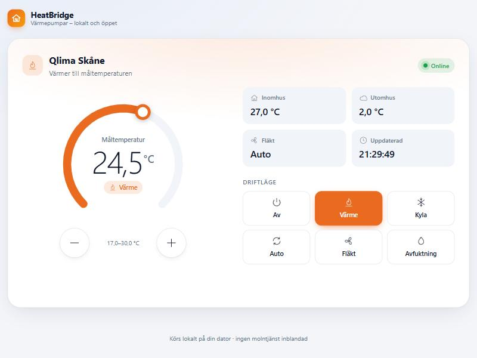

# HeatBridge

HeatBridge is a self-hosted platform for controlling air conditioners and heat pumps through open
protocols, without proprietary clouds such as Tuya, Smart Life or NetHome Plus.

The first supported device is a **Qlima heat pump** with an **SMLIGHT SLWF-01Pro** Wi-Fi module running
**ESPHome** with the Midea UART component. A heat pump can be controlled in two ways:

- **Direct:** the HeatBridge server talks to the heat pump on the local network.
- **Through HeatBridge Agent:** a small service on a computer next to the heat pump (for example a
  Raspberry Pi) talks to the heat pump and keeps an **outbound** WebSocket connection to the server.
  The server never needs to reach the heat pump's private address. This is the foundation for managing
  heat pumps at other locations.

The dashboard (in Swedish) looks and works the same in both cases.



## Contents

- [Features](#features)
- [Requirements](#requirements)
- [Quick start (direct mode)](#quick-start-direct-mode)
- [Configuration](#configuration)
- [Hosting the dashboard on the Pi](#hosting-the-dashboard-on-the-pi)
- [HeatBridge Agent](#heatbridge-agent)
- [Deploying the agent to the Raspberry Pi (printpi)](#deploying-the-agent-to-the-raspberry-pi-printpi)
- [Operating the agent](#operating-the-agent)
- [Testing](#testing)
- [Architecture](#architecture)
- [Roadmap](#roadmap)

## Features

- Live dashboard showing online/offline status, indoor temperature, target temperature, operating mode,
  fan mode, outdoor temperature and the time of the last successful update.
- Large +/− controls in 0.5 °C steps, limited to the range the device reports (17–30 °C on the Qlima).
- Operating modes discovered from the device. Only the modes the device supports are shown
  (Av, Värme, Kyla, Auto, Fläkt, Avfuktning).
- Every command is confirmed by reading the device state back. The UI shows when a command is being
  sent, when it succeeds and when it fails.
- Automatic refresh every 5 seconds without page reloads. Background refreshes never overwrite a change
  you are making.
- HeatBridge Agent for devices behind other networks. It authenticates with a credential unique to each
  agent, accepts only climate commands, verifies every command against the device, reconnects
  automatically and runs unattended under systemd.
- Responsive layout for mobile and desktop, light and dark mode.
- The web app listens on `localhost` only. There is no public control API.

## Requirements

- [.NET 10 SDK](https://dotnet.microsoft.com/download/dotnet/10.0) (10.0.100 or later) on the development
  computer. Windows: `winget install Microsoft.DotNet.SDK.10`.
- For direct mode: a computer on the same network as the heat pump.
- For the agent: a Linux machine next to the heat pump (64-bit Raspberry Pi OS / Debian on arm64). It needs
  neither the .NET SDK nor Docker.

```powershell
dotnet --list-sdks
```

## Quick start (direct mode)

```powershell
git clone <repository-url> heatbridge
cd heatbridge
dotnet run --project src/HeatBridge.Web
```

Open <http://localhost:5171>. The development configuration points to the Qlima at `192.168.50.215`.

## Configuration

Devices are configured under `HeatBridge:Devices`. Each entry has exactly **one transport**, so a physical
device can never be controlled through two paths at once. Using the same `Id` twice fails at startup.

```jsonc
// src/HeatBridge.Web/appsettings.Development.json
{
  "HeatBridge": {
    "Devices": [
      {
        "Id": "qlima-skane",
        "Name": "Qlima Skåne",
        "Transport": "Direct",                    // or "Agent"
        "BaseUrl": "http://192.168.50.215",       // used by Direct only
        "ClimateEntity": "air_conditioner",
        "OutdoorTemperatureSensor": "air_conditioner_outdoor_temperature",
        "RequestTimeout": "00:00:05",
        "AgentId": "printpi"                      // used by Agent only
      }
    ],
    "RemoteAgents": {
      "Enabled": false,
      "Agents": [ { "Id": "printpi", "Name": "printpi (Raspberry Pi, Skåne)" } ]
    }
  }
}
```

| Device setting | Description |
| --- | --- |
| `Id` | Stable identifier: 1–64 letters, digits, `-`, `_` or `.`. Must match the id on the agent. |
| `Name` | Name shown in the UI. |
| `Transport` | `Direct` (default): the server polls the device. `Agent`: the device is reached through `AgentId`. |
| `BaseUrl` | Address of the ESPHome web server (Direct only; ignored for Agent). |
| `ClimateEntity` | Climate entity in the REST URL (`/climate/<ClimateEntity>`). |
| `OutdoorTemperatureSensor` | Optional sensor entity (`/sensor/<name>`) for the outdoor temperature. |
| `RequestTimeout` | Timeout for a single request to the device. |
| `DiscoveryTimeout` | How long to listen on `/events` when discovering supported modes (default 8 s). |
| `SupportedModes` | Optional override, e.g. `["OFF","HEAT"]`. Leave empty to discover modes from the device. |

Application-wide settings live in [`appsettings.json`](src/HeatBridge.Web/appsettings.json):
`PollingInterval` (5 s), `ConfirmationAttempts` (6), `ConfirmationDelay` (0.5 s),
`CapabilityRetryInterval` (1 min), and under `RemoteAgents`: `HeartbeatInterval` (15 s),
`MissedHeartbeatsBeforeOffline` (3), `CommandAckTimeout` (5 s), `CommandResultTimeout` (30 s) and
`DeviceStaleAfter` (60 s).

There are three ways to override settings without editing tracked files:

1. Copy [`appsettings.Local.example.json`](src/HeatBridge.Web/appsettings.Local.example.json) to
   `src/HeatBridge.Web/appsettings.Local.json`. It is git-ignored and overrides all other settings.
2. Use environment variables, e.g. `$env:HeatBridge__Devices__0__BaseUrl = "http://192.168.1.60"`.
3. Use `dotnet user-secrets` (Development only). This is where agent secret hashes go.

### Network binding

`dotnet run` listens on `http://localhost:5171` only, and `AllowedHosts` is restricted to `localhost`,
`127.0.0.1` and `[::1]`. The app has **no user authentication yet**, so do not bind it to `0.0.0.0`
or expose it through your router.

## Hosting the dashboard on the Pi

The lowest-cost standalone setup runs **HeatBridge.Web on the existing Raspberry Pi**, controlling
the Qlima through `Direct` transport. The web service runs continuously under systemd; your computer
accesses it through an **SSH local tunnel**. There is no cloud bill, Docker, VPN or public dashboard.
The web server listens only on `127.0.0.1:5171`. Keep your existing SSH connection and router settings.

This deployment targets **64-bit ARM Linux with systemd** (Raspberry Pi OS/Debian). It requires
Python 3, curl, OpenSSH and the standard Linux tools checked by the preflight. The self-contained
release includes .NET but still requires the OS native libraries used by .NET, including ICU.
`--check-config` validates that the executable runs on the actual Pi before changing services.

### Build and deploy (PowerShell)

Use the SSH hostname/IP, user and port that already work from your computer:

```powershell
# Read-only: inspect architecture, OS, RAM, free disk, ports and service status.
.\deploy\server\deploy.ps1 -Target pi@<host> -Port <ssh-port> -PreflightOnly

# Build the production Linux ARM64 package and its SHA-256 checksum.
.\deploy\server\publish.ps1

# Upload, verify and install. Enter SSH/sudo passwords in your terminal when prompted.
.\deploy\server\deploy.ps1 -Target pi@<host> -Port <ssh-port>
```

Both deployment and tunnel scripts support `-IdentityFile` and `-JumpHost`; existing OpenSSH host
aliases also work. Omit `-Port` for port 22. `-CopyOnly` uploads the archive and prints the install
command. `-Package <path>` selects a particular archive. Deployment verifies its checksum remotely.

The preflight requires **384 MiB available RAM**, **512 MiB free on `/opt`**, **64 MiB free on `/var`**,
and **16 MiB free on `/tmp`**. Releases are staged on disk under `/opt`; `/tmp` only holds small
configuration files, so a RAM-backed `/tmp` is supported. It stops if port 5171 is occupied by another service. Low resources do not cause it
to stop existing services to make room. With an existing web server, these checks run before each update.

On first installation, the installer imports device and polling settings from
`/etc/heatbridge/agent.json` into `/etc/heatbridge-web/web.json`. It sets all devices to `Direct`,
disables remote-agent endpoints and excludes credentials and agent connection settings. These JSON
files must use standard JSON without comments or trailing commas. Existing web settings are never overwritten.

The installer validates configuration, reads the devices without changing them, starts the server,
and checks the private listener, dashboard and CSS/JavaScript assets. **Only after these checks pass
does it stop and disable `heatbridge-agent`.** The agent's files and credentials remain intact.
If activation fails, the installer restores the previous server release/unit and the services'
previous running and boot-enabled states. Other services, including printing and SSH, are not modified.

### Open the dashboard

```powershell
.\deploy\server\tunnel.ps1 -Target pi@<host> -Port <ssh-port>
```

Open <http://localhost:5171>. Keep the terminal open; Ctrl+C closes the tunnel while the server
continues running on the Pi. Add `-Persistent` to reconnect after SSH drops. If port 5171 is already
in use on your computer, add `-LocalPort 5173` and open `http://localhost:5173` instead.
If SSH forwarding is denied, the script reports the failure; it does not alter sshd configuration.

Check that live temperatures appear and that the dashboard reconnects after restarting only the web
service. A Pi reboot is not required for installation or testing.

### Configuration, operation and rollback (Pi)

```bash
sudo heatbridge-webctl status
sudo heatbridge-webctl logs -f
sudo heatbridge-webctl check-config   # no listener and no device polling
sudo heatbridge-webctl verify         # private listener, dashboard/assets, read-only device checks
sudo heatbridge-webctl restart
sudo heatbridge-webctl versions
sudo heatbridge-webctl rollback       # previous release; also accepts an installed version
```

The service is `heatbridge-web`, running as its own unprivileged user with automatic restart,
`MemoryHigh=256M` and `MemoryMax=384M`. Configuration is root-owned, service-readable; persistent
ASP.NET data-protection keys are readable only by the service user. Files are kept separately:

| Location | Purpose |
| --- | --- |
| `/opt/heatbridge/web/releases/<version>` | Self-contained application and release management files |
| `/opt/heatbridge/web/current`, `previous` | Atomic release links |
| `/etc/heatbridge-web/web.json` | Device and private hosting configuration |
| `/var/lib/heatbridge-web/keys` | Persistent data-protection keys, shared across updates/rollbacks |

`HEATBRIDGE_WEB_CONFIG` selects the required external configuration file. When set, precedence is
appsettings/local settings → external file → environment → command line. `HEATBRIDGE_WEB_STATE`
selects the persistent state directory. The systemd unit supplies both; it runs in Production.
Release packages exclude development/local configuration and secrets. Updates and rollbacks preserve
configuration and keys. Releases are retained, so monitor free disk space before repeated updates.

To return to the previous agent-based setup, first run `sudo heatbridge-webctl disable`, restore its
server/tunnel connection, then run `sudo heatbridge-agentctl enable`. This avoids two pollers.
For a future cloud server, use the preserved agent; public dashboard hosting still requires user authentication.

Deployment helpers are tested independently of real services:

```powershell
python -B -m unittest discover -s deploy/server/tests -v
```

Run the same command with `python3` on Linux/WSL to include service activation, failure recovery and
rollback simulations. Windows skips those Linux-specific tests. `publish.ps1` also verifies runtime
files, static assets and the absence of development settings in every package.

To smoke-test a production publish against a fake local device (including key persistence across
restart), with port 5171 free on the development computer:

```powershell
dotnet publish src/HeatBridge.Web -c Release --self-contained false -o artifacts/server-smoke/app
python -B deploy/server/tests/smoke-server.py artifacts/server-smoke/app
```

## HeatBridge Agent

`src/HeatBridge.Agent` is a .NET 10 Worker Service. It reuses `HeatBridge.Core` (device sessions,
polling, read-back confirmation) and `HeatBridge.EspHome` (the same ESPHome client as direct mode).

What it does:

1. Polls its locally configured devices every 5 seconds, also while disconnected from the server.
2. Opens an **outbound** WebSocket to the server (`/agent/connect`) and authenticates with its own
   credential: `X-HeatBridge-Agent: <id>` plus `Authorization: Bearer <secret>`. The server checks the
   credential **before** accepting the WebSocket upgrade.
3. Sends `hello` with its devices. The server answers `welcome` and accepts only the devices configured
   for that agent on the server.
4. Pushes a `deviceStatus` for every device change, and sends a `heartbeat` (with uptime, memory and
   round-trip time) every 15 seconds.
5. Executes `command` messages (`SetTargetTemperature` or `SetMode` only). It replies with a
   `commandAck` straight away. It then sends a `commandResult` once the device has been read back and
   the change confirmed.
6. Reconnects with exponential backoff (1 s, 2 s, 4 s … max 30 s, ±20 % jitter) after any failure.
7. Needs no inbound port and opens no listening socket.

### Security model

| Concern | How it is handled |
| --- | --- |
| Credentials | Each agent has a random 256-bit secret, generated **on the agent**. The server stores only `sha256:<hex>` and compares hashes in constant time. A secret is never stored in Git, in the systemd unit or in the environment. On the Pi it lives in `/etc/heatbridge/agent-secret` (root only, mode 0600) and reaches the service as a systemd credential. |
| Transport | Production uses `wss://` with normal certificate validation; there is no code path that disables validation. Unencrypted `ws://` is accepted only when **all** of the following hold: `DOTNET_ENVIRONMENT=Development`, `AllowInsecureLoopback=true`, and a loopback host (`127.0.0.1`, `::1`, `localhost`), as with an SSH tunnel. Otherwise the agent refuses to start. |
| No proxying | The protocol has no URLs, hosts or raw requests. The server can only send `SetTargetTemperature` or `SetMode` for a device id the agent itself has configured. |
| Validation | Every message is parsed strictly: unknown types, missing fields, nulls, NaN, invalid ids, out-of-range temperatures, oversized messages (> 64 KiB) and binary frames all close the connection. Device limits and supported modes are enforced on both the server and the agent. |
| Duplicates | Each command carries a GUID. The agent remembers recent ids, so a repeated message is acknowledged as a duplicate and never executed twice. The server ignores late or duplicate acks and results. |
| One path per device | A device has exactly one transport. A newer connection from the same agent replaces the older one. |

### Online/offline on the server

- **Agent disconnected or silent:** after missing 3 heartbeats (45 s), or immediately on disconnect,
  all of its devices show **Offline** with "HeatBridge-agenten på platsen är inte ansluten". Commands
  fail at once instead of timing out.
- **Device unreachable from the agent:** the agent reports Offline with the device error (for example
  "Kunde inte nå värmepumpen").
- **Device not reported for 60 s while the agent is connected:** Offline (stale).
- **Command timeouts:** no acknowledgement within 5 s, or no verified result within 30 s.
- `GET /healthz/agents` returns agent connection status, version, host, health and device status as
  JSON (localhost only, no secrets).

## Deploying the agent to the Raspberry Pi (printpi)

The deployment is **supervised**: you run each step and see what happens. Nothing changes on the Pi
until you run the installer. The installer only adds:

- the `heatbridge` system user (no login shell, no home directory)
- `/opt/heatbridge/agent` (the application)
- `/etc/heatbridge` (configuration)
- `/usr/local/sbin/heatbridge-agentctl` (management tool)
- `/etc/systemd/system/heatbridge-agent.service` (the service)

It does not touch CUPS, the web server on port 80, SSH, the firewall or the router, and the agent binds
no port.

Below, replace `pi` with your user name on printpi. Commands marked **Windows** run in PowerShell in the
repository folder; commands marked **Pi** run in an SSH session (`ssh pi@192.168.50.187`).

### 1. Build the release (Windows)

```powershell
.\deploy\agent\publish.ps1
```

This creates `artifacts\agent\heatbridge-agent-<version>-linux-arm64.tar.gz` and a `.sha256` file. The
package contains a self-contained single-file executable (~80 MB, no trimming) plus the installer, the
systemd unit and `heatbridge-agentctl`.

### 2. Copy and install (Windows → Pi)

```powershell
.\deploy\agent\deploy.ps1 -Target pi@192.168.50.187
```

This uploads the package to `~/heatbridge-agent-upload`, verifies its checksum on the Pi, and then runs
`sudo bash install.sh` in an interactive SSH session (you type the sudo password). On the first install
the service is **not** started yet, because there is no secret. To only copy the package, add `-CopyOnly`,
which prints the install command to run yourself.

### 3. Configure the agent (Pi)

```bash
sudo nano /etc/heatbridge/agent.json
```

The defaults already match printpi: `AgentId` `printpi`, the Qlima at `192.168.50.215`, and the server at
`ws://127.0.0.1:5172/agent/connect` through the SSH tunnel. During the tunnel phase, also enable
development mode, which is required for `ws://` to loopback:

```bash
sudo install -m 600 /etc/heatbridge/agent.env.example /etc/heatbridge/agent.env
```

### 4. Create the agent credential (Pi), register it on the server (Windows)

```bash
sudo heatbridge-agentctl new-secret
```

This prints a hash like `sha256:3f5a…`. The secret itself never leaves the Pi. Register the hash with
the development server:

```powershell
.\deploy\agent\Register-Agent.ps1 -SecretHash sha256:3f5a...
```

This stores the hash in the web project's user secrets, outside the repository. In production, set
`HeatBridge__RemoteAgents__Agents__0__SecretHash` in the server's environment instead.

### 5. Start the server in agent mode (Windows)

Stop any running HeatBridge instance (Ctrl+C), then start it with the `http-agent` profile. This profile
enables remote agents and switches the Qlima to `Transport=Agent`:

```powershell
dotnet run --project src/HeatBridge.Web --launch-profile http-agent
```

The server now talks only to the agent; it makes no requests to `192.168.50.215` itself.

### 6. Open the SSH reverse tunnel (Windows, separate terminal)

```powershell
.\deploy\agent\tunnel.ps1 -Target pi@192.168.50.187 -Persistent
```

This makes `localhost:5171` on Windows reachable as `127.0.0.1:5172` **on the Pi only**. It uses the
existing SSH connection, so there are no router or firewall changes. Keep it running. It requires the
Pi's sshd to allow TCP forwarding, which is the Debian default.

### 7. Validate and start the agent (Pi)

```bash
sudo heatbridge-agentctl check-config
sudo heatbridge-agentctl enable
sudo heatbridge-agentctl logs -f
```

Expected log lines:

- `Connected to ws://127.0.0.1:5172/agent/connect`
- `Server accepted agent printpi: 1 device(s)…`
- `qlima-skane is online`

### 8. Verify

- Open <http://localhost:5171>. The Qlima card shows **Online**. Press **+**: the server log shows
  `Command … sent to agent printpi`, and the Pi log shows `Executing command …` followed by
  `confirmed target temperature`.
- Server status: `Invoke-RestMethod http://localhost:5171/healthz/agents`
- The agent listens on no port (Pi): `sudo ss -ltnp | grep -i heatbridge` prints nothing.
- Resource usage (Pi): `systemctl status heatbridge-agent` shows memory use. The unit caps it at
  256 MB (`MemoryMax`).

### Going to production later

1. Put the server behind a reverse proxy with a trusted TLS certificate.
2. Set `"ServerUrl": "wss://<your-host>/agent/connect"` and remove `AllowInsecureLoopback` from
   `/etc/heatbridge/agent.json`.
3. Delete `/etc/heatbridge/agent.env`, so the agent runs as Production.
4. Run `sudo heatbridge-agentctl restart`.

## Operating the agent

| Task | Command (on the Pi) |
| --- | --- |
| Status | `heatbridge-agentctl status` |
| Start / stop / restart | `sudo heatbridge-agentctl start` · `stop` · `restart` |
| Start on boot / disable | `sudo heatbridge-agentctl enable` · `disable` |
| Logs | `sudo heatbridge-agentctl logs` (last 100 lines) · `logs -f` (follow) · `logs --since "1 hour ago"` |
| Validate configuration | `sudo heatbridge-agentctl check-config` |
| Show the hash to register on the server | `sudo heatbridge-agentctl show-hash` |
| Replace the secret | `sudo heatbridge-agentctl new-secret --force`, then update the hash on the server |
| Installed versions | `heatbridge-agentctl versions` |
| Roll back | `sudo heatbridge-agentctl rollback` (previous) or `rollback <version>` |
| Remove | `sudo heatbridge-agentctl uninstall` (`--purge` also removes the configuration and the user) |

**Updating** means running step 1 and step 2 again. Each build gets a unique version
(`0.2.0-<timestamp>-<commit>`), installed side by side under `/opt/heatbridge/agent/releases`. The
installer validates the configuration with the new release, switches the `current` symlink atomically
and restarts the service, which means a few seconds of downtime. If validation fails, the running
version is left untouched. The previous release is kept for `rollback`, and older ones are pruned
(3 are kept).

**Files on the Pi**

```
/opt/heatbridge/agent/current -> releases/<version>   running release (root-owned, read-only)
/opt/heatbridge/agent/previous -> releases/<version>  rollback target
/etc/heatbridge/agent.json         settings (root:heatbridge 0640)
/etc/heatbridge/agent.env          optional overrides, e.g. DOTNET_ENVIRONMENT=Development (root 0600)
/etc/heatbridge/agent-secret       secret (root 0600), passed via LoadCredential
```

The systemd unit ([`deploy/agent/linux/heatbridge-agent.service`](deploy/agent/linux/heatbridge-agent.service))
runs the agent as `heatbridge` with `Type=notify`, `Restart=always`, a read-only file system
(`ProtectSystem=strict`), no capabilities, and memory and task limits. Exit code 78 (invalid
configuration) is not restarted in a loop.

> **Not yet verified on printpi.** The release package, the scripts and the unit have been built and
> syntax-checked on Windows, and the agent has been tested against the real Qlima from the development
> computer, but not on the Pi itself. If the service fails to start there, `sudo heatbridge-agentctl logs`
> shows why. `sudo heatbridge-agentctl check-config` runs the same validation outside systemd, which
> separates configuration problems from sandboxing problems.

### Running the agent on the development computer

The agent can run on Windows against the same heat pump, which is useful when developing:

```powershell
.\deploy\agent\Register-Agent.ps1 -GenerateForLocalAgent   # secret for the local agent + hash for the server
dotnet run --project src/HeatBridge.Web --launch-profile http-agent
dotnet run --project src/HeatBridge.Agent                  # second terminal; uses appsettings.Development.json
```

## Testing

```powershell
dotnet test
```

232 automated .NET tests, all using mocked HTTP, fake devices or in-memory WebSockets, with no network:

- **ESPHome:** JSON parsing (numbers as strings, `nan`, unexpected payloads), request building with
  invariant culture, timeouts, unreachable devices, `/events` parsing.
- **Device sessions:** temperature limits, command confirmation, and serialisation of polling and commands.
- **Protocol:** strict parsing and validation of every message type, size limits, binary frames,
  ordering, and secret hashing.
- **Agent:** configuration and transport-security rules, secret resolution (environment, file, systemd
  credential), backoff, command processing (acknowledgements, duplicates, unknown devices, limits,
  hanging and crashing devices).
- **Server (TestServer + real agent worker):** authentication (valid, wrong secret, unknown, disabled or
  missing credentials, plain HTTP), connection and disconnection, status reporting, command dispatch and
  verification, ack and result timeouts, duplicate results, reconnection after drops and while the server
  is unreachable, heartbeat timeout, stale devices, multiple devices, one failing device not affecting
  others, connection replacement, and rejection of protocol violations.
- **Configuration:** one transport per device, unknown agents, missing secret hashes.

## Architecture

```
HeatBridge.slnx
├── src/HeatBridge.Core       Device-agnostic models, IDeviceSession, DeviceSession, polling
├── src/HeatBridge.EspHome    ESPHome web server integration (REST + SSE)
├── src/HeatBridge.Protocol   Agent ⇄ server wire protocol: messages, validation, WebSocket framing, credentials
├── src/HeatBridge.Agent      Worker Service for the site (Raspberry Pi), systemd-ready
├── src/HeatBridge.Web        Blazor dashboard, agent endpoint and hub
├── tests/HeatBridge.Tests    xUnit tests
└── deploy/agent              publish/deploy/tunnel scripts, installer, systemd unit, heatbridge-agentctl
```

```
                    ┌──────────────────────── HeatBridge.Web (server) ───────────────────────────┐
Browser ⇄ SignalR ⇄ │ ThermostatCard ─► DeviceRegistry ─┬─► DeviceSession ─► EspHome ─► device  │  Direct
                    │   (IDeviceSession only)           └─► RemoteDeviceSession ─► AgentHub ◄─┐  │  Agent
                    └──────────────────────────────────────────────────────────────────────┬──┘──┘
                                              /agent/connect (WebSocket, outbound from the agent)
                    ┌──────────────────────── HeatBridge.Agent (printpi) ──────────────────▼───────┐
                    │ AgentWorker ─► AgentSession ─► CommandProcessor ─► DeviceSession ─► EspHome ─┼─► Qlima
                    │                 (hello, status, heartbeats)          ▲ DevicePollingService │   192.168.50.215
                    └──────────────────────────────────────────────────────────────────────────────┘
```

- **`IDeviceSession`** (Core) is everything the dashboard needs: snapshot, change event, set
  temperature and set mode. `DeviceSession` implements it for directly reachable devices, and
  `RemoteDeviceSession` implements it for agent devices. The UI does not know which one it has.
- **`DeviceSession`** (Core) owns one device's state and serialises all I/O with it. Refreshes are skipped
  while a command runs, and commands wait for a running refresh. Commands are validated, sent, then
  confirmed by read-back, because ESPHome answers `200 OK` even for values it ignores. The same class runs
  in the server (direct mode) and in the agent.
- **`DevicePollingService`** (Core) polls only local devices. There is one poller per process, and
  remote devices are polled by their agent, never by the server.
- **`AgentHub`** (Web) authenticates agents, tracks connections (a newer connection replaces an older
  one), maps reports onto the per-agent device registry, and dispatches commands with correlation ids,
  acknowledgements and timeouts. `AgentHubMonitor` runs its health check every second.
- **`AgentWorker` / `AgentSession` / `CommandProcessor`** (Agent) handle the reconnect loop, one
  connected session (handshake, status, heartbeats, dead-connection detection), and command
  validation, de-duplication and execution.
- **`ProtocolConnection`** (Protocol) wraps a WebSocket for both sides. It reads text frames up to
  64 KiB, validates every message before the handler sees it, uses a single ordered send loop, and
  closes with a meaningful status on violations.

### ESPHome API used

| Purpose | Request |
| --- | --- |
| Read climate (verified on the Qlima) | `GET /climate/air_conditioner?detail=all` |
| Read outdoor temperature | `GET /sensor/air_conditioner_outdoor_temperature` |
| Set target temperature (verified on the Qlima) | `POST /climate/air_conditioner/set?target_temperature=24.5` |
| Set mode | `POST /climate/air_conditioner/set?mode=HEAT_COOL` |
| Discover supported modes | `GET /events` (first `state` event for `climate-air_conditioner`) |

- Numbers such as `min_temp` and `target_temperature` are JSON strings, while `step` is a number. The
  parser accepts both, and treats `nan` as "unknown".
- The Midea component reports `OFF, HEAT_COOL, COOL, HEAT, FAN_ONLY, DRY`. There is no `AUTO`, so the
  "Auto" button sends `HEAT_COOL`.
- This firmware lists the supported modes only on `/events`. Newer ESPHome includes them with `?detail=all`.

## Roadmap

- **Cloud server:** Docker on a small Linux VPS behind a TLS reverse proxy. Agents connect over `wss://`,
  and `/healthz` and `/healthz/agents` are ready for monitoring.
- **User authentication** before the dashboard is exposed beyond `localhost`.
- **Live updates via SSE** on the agent instead of polling (`EspHomeClient.ReadClimateFromEventStreamAsync`
  already parses `/events`).
- **Temperature history** in a database, fed from `IDeviceSession.SnapshotChanged`.
- **WireGuard** as an alternative site link (the agent protocol works over any network that reaches the server).
- **More controls** (fan mode, swing, presets). The device exposes these and they are parsed already.
  New command kinds need explicit protocol support.

## License

To be decided by the project owners before publishing.
